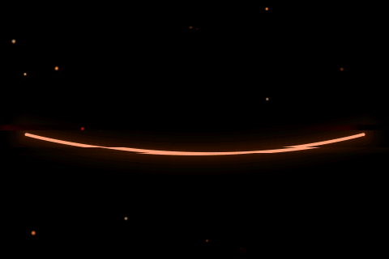
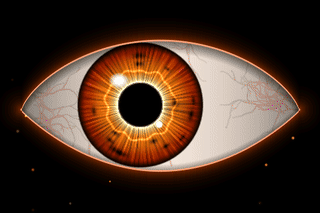
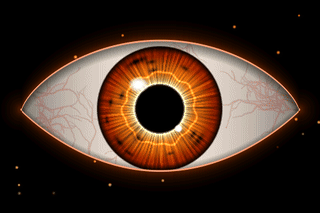
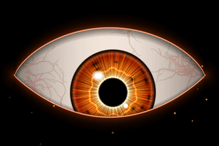
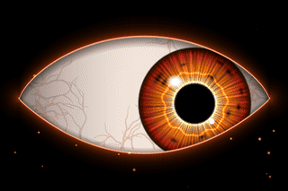
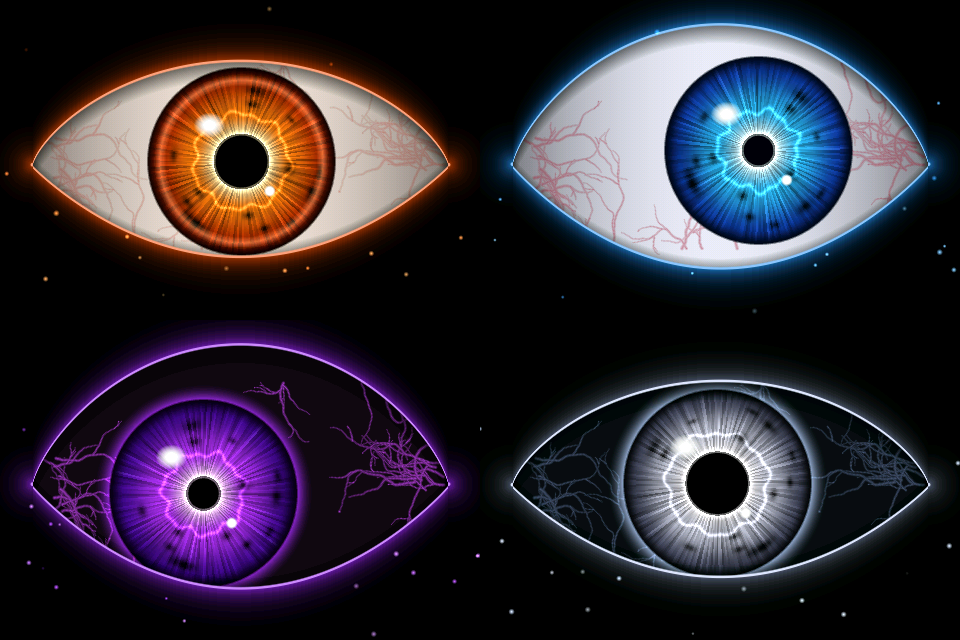

<div align="center">



# Third Eye

**A living eye you wear on a lanyard.**

It looks around, blinks, follows your finger, side-eyes people, and loses it if you poke it too much.


[Modes](#what-it-does) · [Parts](#what-you-need) · [Install](#install) · [Battery](#battery-and-wearing-it) · [Troubleshooting](#troubleshooting) · [Customize](#make-it-yours)

</div>

---

## What it does

<table>
<tr>
<td align="center" width="50%"><br><b>Tap</b><br>Looks at your finger, flinches, then blinks</td>
<td align="center" width="50%"><br><b>Double-tap: side-eye</b><br>Squints and slowly looks away for about 3 seconds</td>
</tr>
<tr>
<td align="center"><br><b>Hold: stare</b><br>Opens wide, follows your finger, never blinks</td>
<td align="center"><br><b>4 fast taps: rage</b><br>Red, slit pupil, flared veins, shaking. Calms down after about 4 seconds</td>
</tr>
</table>

| Do this | It does this |
|---|---|
| Nothing | Looks around, blinks, breathes, floats embers, glitches every 10 seconds or so |
| Leave it alone for 25+ seconds | Side-eyes someone on its own |
| Keep holding for about 8 seconds | Blinks and changes colour |
| Hold 2 fingers for 2 seconds | Opens the setup screen |

### Four colours

<div align="center">


**EMBER · FROST · VOID · PHANTOM**
</div>

VOID and PHANTOM have a black sclera with glowing veins. They look best in a dark room.

## What you need

- **Freenove ESP32-S3 Display 4.0" (FNK0104S)**: 320x480 IPS, capacitive touch, 16 MB flash, 8 MB PSRAM
- A USB-C **data** cable (some charge-only cables won't work)
- Optional: a 1S LiPo (the estimate below assumes 1300 mAh) and a lanyard

All pins come from Freenove's own setup files for this exact board. Other boards need new pins and possibly a new display driver in `config.h` and `ThirdEye.ino`.

## Install

### 1. Set up the software (once, about 10 minutes)

1. Install **[Arduino IDE 2](https://www.arduino.cc/en/software)**.
2. Go to **Arduino IDE → Settings → Additional boards manager URLs** and paste:
   ```
   https://espressif.github.io/arduino-esp32/package_esp32_index.json
   ```
3. In **Boards Manager**, install **esp32 by Espressif Systems**. Compile-checked on 3.0.7 and 3.3.12.
4. In **Library Manager**, install **LovyanGFX by lovyan03**. Compile-checked on 1.2.7 and 1.2.34.

That's the only library. You don't need TFT_eSPI or any of Freenove's libraries.

### 2. Get the code

```bash
git clone https://github.com/theChitranshM/ThirdEye.git
```

Arduino needs the folder name to match the `.ino` name, so keep the folder called `ThirdEye`. If you use **Download ZIP**, rename the extracted `ThirdEye-main` folder to `ThirdEye`.

### 3. Choose the board settings (Tools menu)

| Setting | Value |
|---|---|
| Board | **ESP32S3 Dev Module** |
| USB CDC On Boot | **Enabled** |
| Flash Size | **16MB (128Mb)** |
| Partition Scheme | **16M Flash (3MB APP/9.9MB FATFS)** |
| PSRAM | **OPI PSRAM** |
| Everything else | Leave as is |

Set PSRAM to OPI, or the eye will run without its veins.

### 4. Upload

1. Plug in the board and pick its port under **Tools → Port** (on a Mac: `/dev/cu.usbmodem…`).
2. Open `ThirdEye/ThirdEye.ino` and click **Upload**. The first compile takes 1–2 minutes.
3. If the upload fails with "no serial data received" or the port disappears: hold **BOOT**, tap **RESET**, release **BOOT**, and upload again. Tap **RESET** when it finishes.

The eye boots with a glitch, opens slowly, looks left, looks right, then looks straight at you.

### 5. Check the setup screen

Hold **2 fingers** on the screen for **2 seconds**.

- **SWAP COLORS**: use this if a RED / GREEN / BLUE label doesn't match its colour. The board restarts itself.
- **FLIP 180**: use this if the eye is upside down the way it hangs on you.
- **DIMMER / BRIGHTER**: 150–200 is plenty in a dark room and saves battery.
- **PALETTE**: picks the colour.
- **DONE**: goes back to the eye. Everything stays saved after unplugging.

## Battery and wearing it

> [!CAUTION]
> **Check polarity before you plug the battery in.** Cheap batteries come wired both ways, and plugging one in backwards can kill the board. On the back of the board, the **BAT** socket has a small white dot next to the **+** pin. The battery's **red** wire must land on the dot side. If it doesn't, swap the two pins in the plug (lift each plastic tab with a needle and slide the metal pin out), or use a power bank instead.

- **Charging:** plug in USB-C with the battery connected. It charges while running.
- **Runtime:** roughly 3–4 hours on 1300 mAh at brightness 180 (an estimate, not measured).
- **Low battery:** under 3.45 V it dims itself. The Serial Monitor shows the voltage every 2 seconds.
- **Off switch:** there isn't one. Unplug the battery.
- **Mounting:** put electrical tape or cardboard on the back of the board, then attach the battery with foam tape. Don't press it onto the chips, bend it, puncture it, or leave it in a hot car.
- **Lanyard:** thread it through the two top corner holes with zip ties or split rings.
- **Back glow:** the RGB LED on the back casts the eye's colour onto your shirt. Set it with `BACK_GLOW` in `config.h`.

## Troubleshooting

| Problem | Fix |
|---|---|
| Screen stays black with the backlight on | Check the board is the **FNK0104S**, then look for errors in the Serial Monitor at 115200 |
| "Out of memory" on screen | Set **Tools → PSRAM → OPI PSRAM** and upload again |
| Wrong colours (blue eye, orange sky) | Hold 2 fingers for 2 seconds, then tap **SWAP COLORS** |
| Colours look like a photo negative | Set `PANEL_INVERT` to `false` in `config.h` |
| Snow or tearing that isn't the glitch effect | Set `PANEL_SPI_HZ` to `40000000` in `config.h` |
| Touch hits the wrong spot | Make sure **FLIP 180** matches how the badge hangs |
| Upload fails | Try the BOOT + RESET steps above, another cable, or another USB port |
| Serial Monitor is empty | Set USB CDC On Boot to **Enabled** and use 115200 baud |

## Make it yours

- **`config.h`:** `START_BRIGHTNESS`, `START_PALETTE`, `BACK_GLOW`
- **`PALETTES[]` in `eye_render.h`:** the colours. Add your own.
- **`IRIS_R`, `EYE_HW`, `EYE_UP`, `EYE_DN` in `eye_render.h`:** iris size and eye shape
- **`M_STARE`, `M_ANGRY`, `M_SUS` in `Brain::update`:** how open the eye gets, pupil size, and vein strength for each mood

## Preview it without the board

`tools/preview.cpp` runs the same renderer on a laptop and writes frames. The GIFs in this README were made this way, so they're the real eye with a scripted finger.

```bash
cd ThirdEye/tools
g++ -O2 -std=c++17 preview.cpp -o preview
mkdir frames && ./preview frames 48 30
ffmpeg -framerate 30 -i frames/f%05d.ppm -vf scale=960:640 -pix_fmt yuv420p preview.mp4
```

On a Mac, if the compiler can't find `<cstdio>`, add `-isysroot "$(xcrun --show-sdk-path)"` to the `g++` line.

## What's in here

```
ThirdEye/
├── ThirdEye.ino      the sketch: display, touch, setup screen, battery
├── eye_render.h      the eye: drawing and behaviour
├── config.h          brightness, starting colour, back glow, pins
├── ui_types.h        two small structs
├── tools/preview.cpp the laptop preview
└── assets/           images for this README
```

---

<div align="center">

Built with [Claude Code](https://claude.com/claude-code) for Halloween 2026 by [Chitransh](https://github.com/theChitranshM). MIT licensed, so go build your own.

</div>
